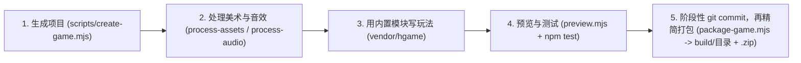

# HGame 全景使用手册（人类速查 & AI Agent 操作说明书）

HGame 的能力很多，但真正常用的入口非常清晰。你只需要记住 **两个目录的区别** 和 **五步标准工作流**，就不会再混乱。

---

## 一、一图看懂 HGame：两个目录 + 5 步标准工作流

使用 HGame 时，磁盘上永远只有两类目录：

1. **HGame 引擎源仓库（本仓库）**：负责生成新游戏、切图去背、音频筛选、本机预览、打包任意外部项目，以及可选的多人联网后端（`network/`）。
2. **生成的独立游戏工程（例如 `D:\Games\lol`）**：由 `create-game.mjs` 创建出来的独立项目，内置了裁剪好的 `vendor/hgame/` 运行时、`AGENTS.md` 规范、`scripts/package-game.mjs` 打包器与独立 Git，**不依赖 CDN**。日常写游戏玩法、测单测、打发布包都在这里完成。

> **Git 提交与推送纪律**：无论是开发引擎还是独立游戏，每完成一个阶段性成果并通过测试校验后就立即 `git commit` 并推送远程仓库（如已配置 `origin` 则执行 `git push`），不要在 `main` 分支长期堆积未提交改动（多阶段工作先建短生命周期特性分支如 `feat/*`、`perf/*`，逐阶段提交推送后再合并回 `main`）。

---

## 二、项目创建选型决策表（`scripts/create-game.mjs`）

在 HGame 引擎根目录先执行 `npm ci`，再按游戏类型选择一条命令生成项目：

> 注意：目标目录最后一个文件夹名必须使用纯英文/数字/`-`/`_`（例如 `lol`、`my-2d-game`），中文展示名请用 `--name "你的游戏名"` 指定。

| 你想做什么游戏？ | Profile | 推荐渲染器 | 是否带物理 / 画质 | 可直接复制的建项命令（从 HGame 根目录运行） |
|---|---|---|---|---|
| **常规 2D 动作 / 平台 / 肉鸽** | `2d` | `canvas2d`（默认） | 可选 `--with physics2d` | `node scripts/create-game.mjs "D:\Games\my-2d-game" --profile 2d --with audio,save --name "我的2D游戏"` |
| **2D 类幸存者 / 万怪潮（5,000–150,000+ 同屏）** | `2d` | `webgl2d`（无 WebGL2 自动回退 Canvas2D） | `createSwarmSimulation` / `createGpuSwarmWebGL2` + `SpriteCrowd2D.bindSwarm`（零 GC） | `node scripts/create-game.mjs "D:\Games\my-horde" --profile 2d --renderer webgl2d --with audio,save --name "幸存者 Demo"` |
| **3D 动作 / 第一人称 / 万人怪潮** | `3d` | `threejs`（默认） | `--quality auto`，大量骨骼怪加 `createBoneVatCrowd3D` | `node scripts/create-game.mjs "D:\Games\my-3d-game" --profile 3d --quality auto --with physics3d,model3d,audio,save --name "我的3D游戏"` |
| **卡牌 / 文字冒险 / 商业化养成 UI** | `ui` | `dom`（默认，零空转 RAF） | 不需要物理 | `node scripts/create-game.mjs "D:\Games\my-ui-game" --profile ui --with audio,save --name "星域卡牌"` |
| **联机游戏前端** | `2d` 或 `3d` | 任意 | 离线/在线使用同一确定性 Rapier 版本 | 先按上表生成单机游戏，再对接 `network/` 房态协议（见 [systems/12-physics-trace-network.md](systems/12-physics-trace-network.md)） |

常用建项附加参数：
- `--with save,audio,assets,diagnostics,physics2d,animation2d,tilemap2d,pathfinding2d,physics3d,model3d`
- `--physics rapier2d | rapier3d | none`
- `--tick-hz 60`（`ui` 固定为 `0`；2D/3D 支持 `1..240`）
- `--quality auto | low | medium | high | ultra`（仅 `--profile 3d` 建项参数，3D 默认已包含自研 Three.js + 世界对齐 PBR）
- `--no-git`：不自动执行 `git init`
- `--dry-run`：只打印将生成的配方 JSON，不写磁盘

---

## 三、子系统速查(按需读取,避免一次性载入全部)

先查 `docs/api/API-INDEX.json`(机器可读签名),需要用法和坑点时再读下面对应文件。

| 主题 | 文件 |
|---|---|
| 4.1 核心生命周期、渲染插值与 GameplayTags | [systems/01-core-lifecycle-tags.md](systems/01-core-lifecycle-tags.md) |
| 4.2 补间动画 Tween 与弹簧阻尼手感 | [systems/02-tween-spring.md](systems/02-tween-spring.md) |
| 4.3 2D 精灵、算法地面阴影、图集切帧与 A* 寻路 | [systems/03-sprite-2d-pathfinding.md](systems/03-sprite-2d-pathfinding.md) |
| 4.4 2D 万怪同屏（5,000–10,000+ 对象：WebGL2D + SpriteCrowd2D + SpatialHash2D） | [systems/04-horde-2d.md](systems/04-horde-2d.md) |
| 4.5 3D 渲染、UE 电影级色调、程序化天空与 MegaLights 多光源 | [systems/05-render-3d-megalights.md](systems/05-render-3d-megalights.md) |
| 4.6 3D 后处理体积栈、遮挡剔除、GPU 实例化与 3D 弹簧臂相机 | [systems/06-post-culling-camera-3d.md](systems/06-post-culling-camera-3d.md) |
| 4.7 3D 骨骼角色（GLB）、VAT 千人同屏、世界对齐 PBR 与开放世界 | [systems/07-model-vat-open-world.md](systems/07-model-vat-open-world.md) |
| 4.8 低 / 中 / 高三档画质统一调节（2D & 3D） | [systems/08-quality-tiers.md](systems/08-quality-tiers.md) |
| 4.9 手机触屏优先 + 虚拟摇杆/技能键 + PC 双人分屏标准（必读） | [systems/09-touch-arcade-splitscreen.md](systems/09-touch-arcade-splitscreen.md) |
| 4.10 中国商业化分层红点系统（Trie 树 + DAG 跨入口去重 + DOM 绑定） | [systems/10-red-dot.md](systems/10-red-dot.md) |
| 4.11 美术切图去背管线 + 3D HRTF 空间音效与多变种防连重 Cue | [systems/11-art-audio-pipeline.md](systems/11-art-audio-pipeline.md) |
| 4.12 确定性物理、行为轨迹录制与多人联网 | [systems/12-physics-trace-network.md](systems/12-physics-trace-network.md) |

---

## 四、全命令速查总表

| 场景 | 在哪里运行 | 完整命令 | 说明 |
|---|---|---|---|
| **安装引擎依赖** | HGame 根目录 | `npm ci` | 安装测试、物理构建与打包压缩可选依赖 |
| **新建游戏项目** | HGame 根目录 | `node scripts/create-game.mjs "<目标路径>" --profile <2d\|3d\|ui> [--renderer webgl2d] [--with ...] [--quality auto] --name "中文名"` | 创建独立游戏工程，自动复制最小化 Runtime 与 Three/Rapier（按需） |
| **切图去背脚本** | HGame 根目录 | `npm run process:assets -- --input sheet.png --grid 3 --bg green --mode actor --out-dir assets/actors` | `--grid 1\|2\|3`、`--bg transparent\|green\|white`、`--mode actor\|icon\|background`、`--names a,b,c`、`--bake-shadow` |
| **音效变种处理** | HGame 根目录 | `npm run process:audio -- --cue rifle --inputs a.mp3,b.mp3,c.mp3,d.mp3 --out-dir assets/audio/sfx` | 需本机 `ffmpeg`；加 `--bgm` 按双声道 BGM 规范导出 |
| **本机预览游戏** | HGame 根目录 | `node scripts/preview.mjs "<游戏路径或 build 子目录>" --port 4176` | 回环只读静态 HTTP 服务，拦截 `.git`/`AGENTS.md`/`tests`/`scripts`/`build` |
| **独立游戏精简打包** | **独立游戏根目录** | `npm run release -- --version 1.1`（或 `npm run build`） | 产出 `build/<id>_1_1/` 与 `build/<id>_1_1.zip`，只含真实依赖模块与启用维度的 WASM |
| **从引擎仓打包外部游戏** | HGame 根目录 | `npm run package:game -- "<游戏路径>" --version 1.1` | 即使游戏后期修改 `engine.config.json` 新开启物理，也能自动从引擎仓补齐对应 WASM 并校验 |
| **打包扁平根目录 ZIP** | 游戏或引擎根目录 | `node scripts/package-game.mjs [目录] --version 1.1 --flat-zip` | 压缩包根目录直接是 `index.html`，适合部分直接解压托管平台 |
| **其他常用打包参数** | 任意 | `--id lol` `--tag lol_1_1` `--out-dir build` `--engine-root <hgame>` `--no-minify` | 覆盖 `game.config.json` 标识、目录名或关闭 `esbuild` 语法压缩 |
| **全量发布引擎 SDK** | HGame 根目录 | `npm run release` | 重建 Rapier + 跑全部校验/联机测试 + 生成 `build/hgame_1_0/` 与 `build/hgame_1_0.zip` |
| **全量校验（含网络）** | HGame 根目录 | `npm ci --prefix network` 后运行 `npm run check:all` | 运行 `npm test` + `check:physics` + `network` 测试/类型检查/构建 |
| **浏览器 Playwright 验收** | HGame 根目录 | `node tests/browser-profiles.mjs --playwright "<path>" --chrome "<chrome.exe>"` | 需本机已有 Chromium 与 `playwright-core`；未跑不要宣称已通过浏览器实测 |

---

## 五、11 条防踩坑黄金铁律

1. **只保留一个主循环**：一切固定物理步与画面刷新由 `app.start()` 托管，严禁在组件里另开 `requestAnimationFrame`。
2. **不要把游戏规则写进 `vendor/hgame/`**：在独立游戏中，`vendor/hgame/` 只是精简运行时副本；游戏玩法、数值、AI、存档结构必须放在 `src/`。
3. **发布千万别直接压缩整个工程文件夹**：必须用 `npm run release` / `scripts/package-game.mjs`，才能只打包用到的模块和已校验 `.wasm`，剔除 `.git`、`tests`、`scripts`、`AGENTS.md` 与 PSD/Blend 源文件。
4. **UI 型项目严禁空转 60Hz**：卡牌、文字、养成界面使用 `--profile ui`（`tickHz: 0`），按点击与事件重绘（`app.dispatch(...)`）。
5. **改材质/模型不准改碰撞与权威状态**：3D 的模型槽位（`model-slots.json`）、材质与世界对齐贴图仅负责显示，关卡碰撞请在 `level.json` `colliders` 中独立维护。
6. **大数量 2D 不要用上万个 Entity + Sprite2D**：类幸存者怪潮和弹幕请用 `renderer: 'webgl2d'` + `SpriteCrowd2D` + `SpatialHash2D` + `ObjectPool`。
7. **美术原图不要带地面阴影**：角色立绘/序列帧保持干净无脚底黑影，由 `Sprite2D.groundShadow = true` 或 `SpriteCrowd2D` 运行时绘制，才能匹配缩放与跳跃动作。
8. **移动端操作先想直觉触控，再加摇杆技能键**：能点按/拖拽直接玩的优先用 `app.input.pointers`；需摇杆和技能按钮时严格遵循 P1 `WASD + JKL UIO`（默认 `touch-only` 不遮挡桌面）、P2 `方向键 + 123456`。
9. **多层 UI 徽章不要用散装布尔值**：所有多页/跨入口红点用 `createRedDotSystem` + `bindRedDotDOM`，靠 Trie 冒泡与 DAG 去重确保“子页未清、父点不灭”。
10. **测试汇报必须老实**：只跑了 Node 单元测试（`npm test`）不能写“浏览器真机已验收”；跑过 `tests/browser-profiles.mjs` 才可写浏览器已验证。
11. **阶段性成果立即提交并推送远程，严禁在 `main` 分支堆积改动**：每完成并通过校验（`npm run check` / `npm test`）一个阶段性节点就立即 `git commit` 并推送远程仓库（`git push`）；多阶段功能或性能改造先切短生命周期特性分支（如 `feat/*`、`perf/*`、`fix/*`）按阶段小步提交推送，全部通过校验后再合并回 `main`，保持 `main` 与远程分支随时干净且同步。

---

## 六、延伸专题文档

- 架构总览与边界：[ENGINE-OVERVIEW.md](../architecture/ENGINE-OVERVIEW.md)
- 平台服务、音频与输入 API：[PLATFORM-API.md](../architecture/PLATFORM-API.md)
- 确定性物理与快照：[DETERMINISTIC-PHYSICS.md](../architecture/DETERMINISTIC-PHYSICS.md)
- 3D 渲染管线、MegaLights 与开放世界：[PIPELINE-3D.md](../rendering/PIPELINE-3D.md)
- 世界坐标对齐 PBR 材质：[WORLD-ALIGNED-PBR.md](../rendering/WORLD-ALIGNED-PBR.md)
- 美术切图去背与空间音频规范：[ASSET-AND-AUDIO-PIPELINE.md](./ASSET-AND-AUDIO-PIPELINE.md)
- 游戏开发架构与浏览器 QA 矩阵：[GAME-ARCHITECTURE-AND-QA.md](./GAME-ARCHITECTURE-AND-QA.md)
- 多人联网同步架构：[NETWORK.md](../architecture/NETWORK.md) & 帧同步：[LOCKSTEP.md](../architecture/LOCKSTEP.md)
- WASM 保护与服务端防作弊：[WASM-PROTECTION-AND-ANTI-CHEAT.md](./WASM-PROTECTION-AND-ANTI-CHEAT.md)
