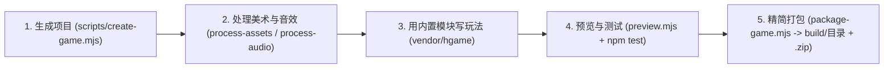

# HGame 全景使用手册（人类速查 & AI Agent 操作说明书）

HGame 的能力很多，但真正常用的入口非常清晰。你只需要记住 **两个目录的区别** 和 **五步标准工作流**，就不会再混乱。

---

## 一、一图看懂 HGame：两个目录 + 5 步标准工作流

使用 HGame 时，磁盘上永远只有两类目录：

1. **HGame 引擎源仓库（本仓库）**：负责生成新游戏、切图去背、音频筛选、本机预览、打包任意外部项目，以及可选的多人联网后端（`network/`）。
2. **生成的独立游戏工程（例如 `D:\Games\lol`）**：由 `create-game.mjs` 创建出来的独立项目，内置了裁剪好的 `vendor/hgame/` 运行时、`AGENTS.md` 规范、`scripts/package-game.mjs` 打包器与独立 Git，**不依赖 CDN**。日常写游戏玩法、测单测、打发布包都在这里完成。



---

## 二、别人拿到 HGame 怎么交给 AI Agent 用？

### 3 种交接方式

- **方式 A：直接把 HGame 引擎仓交给 AI（或把用户拉到本仓库提问）**
  - 本仓库已内置规则 [AGENTS.md](../../AGENTS.md) 与工作区技能 [`.agents/skills/hgame/SKILL.md`](../../.agents/skills/hgame/SKILL.md)。
  - 兼容的 AI Coding Agent（如 Antigravity、Codex、Claude Code、Cursor 等）打开仓库后会自动识别规范，知道如何建工程、复用哪些模块、如何导出可上传发布包。
- **方式 B：只把生成的独立游戏工程交给别人 / AI**
  - 即使对方手里没有 HGame 主仓库，生成的每个独立游戏根目录也自带完整的 `AGENTS.md`、`README.md`、`vendor/hgame/README.md` 和 `scripts/package-game.mjs`。
  - 别人拿到独立游戏目录后，直接让 AI 继续开发玩法、执行 `npm test` 和 `npm run release -- --version 1.1` 即可。
- **方式 C：安装为全局 AI Skill（可选）**
  - 若希望在电脑上任何目录建新游戏都能唤起，可将本仓库 `.agents/skills/hgame/` 复制到所用 Agent 的全局技能目录中。

### 5 套直接复制就能用的中文 Prompt 模板

> 如果你一时记不住所有命令和参数，直接把下面对应的提示词发给 AI：

1. **新建 2D 类幸存者 / 弹幕游戏（万怪同屏 + 触屏摇杆）**
   > 请使用当前 HGame 引擎在 `D:\Games\survivor-demo` 生成一个 2D WebGL2 实例化游戏（`--profile 2d --renderer webgl2d --with audio,save --name "幸存者 Demo"`），按 `AGENTS.md` 和 `docs/guides/USER-AND-AGENT-GUIDE.md` 使用 `SpriteCrowd2D` + `SpatialHash2D` 承接大量怪物，并使用 `createArcadeControls` + `createTouchControls` 做好手机触屏摇杆与 PC `WASD + JKL UIO` 适配。

2. **新建 3D 动作 / 开放世界游戏**
   > 请用 HGame 在 `D:\Games\action-3d` 创建一个 3D 游戏（`--profile 3d --quality auto --with physics3d,model3d,audio,save --name "荒野试炼"`），集成 `sky3d` 天空、`lighting3d` MegaLights / 探针、`post3d` UE Filmic 与体积栈、`camera3d` 弹簧臂，并暴露低/中/高三档画质切换。

3. **新建 UI / 卡牌 / 剧情养成游戏（商业化红点）**
   > 请用 HGame 在 `D:\Games\card-rpg` 创建一个 UI 型游戏（`--profile ui --with audio,save --name "星域卡牌"`），不要创建空转 60Hz RAF，使用 `HGame.createRedDotSystem` + `bindRedDotDOM` 建立多级页面与交叉入口红点，确保子页面全部处理完才熄灭父页面红点。

4. **批量处理 AI 美术与音效变种**
   > 请按 HGame 管线处理我刚生成的素材：用 `scripts/process-assets.mjs` 把这批九宫格绿色背景角色图切成**无地面阴影** PNG；用 `scripts/process-audio.mjs` 从 4 个枪声变种里筛选时长和响度最一致的 2~4 个统一导出 MP3，并在游戏内用 `audio.registerCue` / `playCue` 接入 3D HRTF 左右耳空间音效。

5. **上线前自检并生成精简安装包（含 WASM）**
   > 请运行测试与代码检查，然后用 `package-game.mjs` 为当前游戏生成版本号为 `1.1` 的精简发布目录和压缩包（`build/<id>_1_1/` 与 `build/<id>_1_1.zip`），确认排除 `.git/`、`tests/`、`scripts/` 和原始美术工程文件，并用 `preview.mjs` 启动打包产物确认能正常访问。

---

## 三、项目创建选型决策表（`scripts/create-game.mjs`）

在 HGame 引擎根目录先执行 `npm ci`，再按游戏类型选择一条命令生成项目：

> 注意：目标目录最后一个文件夹名必须使用纯英文/数字/`-`/`_`（例如 `lol`、`my-2d-game`），中文展示名请用 `--name "你的游戏名"` 指定。

| 你想做什么游戏？ | Profile | 推荐渲染器 | 是否带物理 / 画质 | 可直接复制的建项命令（从 HGame 根目录运行） |
|---|---|---|---|---|
| **常规 2D 动作 / 平台 / 肉鸽** | `2d` | `canvas2d`（默认） | 可选 `--with physics2d` | `node scripts/create-game.mjs "D:\Games\my-2d-game" --profile 2d --with audio,save --name "我的2D游戏"` |
| **2D 类幸存者 / 弹幕（5,000–10,000+ 同屏）** | `2d` | `webgl2d`（无 WebGL2 自动回退 Canvas2D） | 一般纯数值碰撞即可 | `node scripts/create-game.mjs "D:\Games\my-horde" --profile 2d --renderer webgl2d --with audio,save --name "幸存者 Demo"` |
| **3D 动作 / 第一人称 / 大世界** | `3d` | `threejs`（默认） | 建议 `--quality auto`，物理用 `--with physics3d` | `node scripts/create-game.mjs "D:\Games\my-3d-game" --profile 3d --quality auto --with physics3d,model3d,audio,save --name "我的3D游戏"` |
| **卡牌 / 文字冒险 / 商业化养成 UI** | `ui` | `dom`（默认，零空转 RAF） | 不需要物理 | `node scripts/create-game.mjs "D:\Games\my-ui-game" --profile ui --with audio,save --name "星域卡牌"` |
| **联机游戏前端** | `2d` 或 `3d` | 任意 | 离线/在线使用同一确定性 Rapier 版本 | 先按上表生成单机游戏，再对接 `network/` 房态协议（见第 4.12 节） |

常用建项附加参数：
- `--with save,audio,assets,diagnostics,physics2d,animation2d,tilemap2d,pathfinding2d,physics3d,model3d`
- `--physics rapier2d | rapier3d | none`
- `--tick-hz 60`（`ui` 固定为 `0`；2D/3D 支持 `1..240`）
- `--quality auto | low | medium | high | ultra`（仅 `--profile 3d` 建项参数，3D 默认已包含自研 Three.js + 世界对齐 PBR）
- `--no-git`：不自动执行 `git init`
- `--dry-run`：只打印将生成的配方 JSON，不写磁盘

---

## 四、“我想做 X 功能，用哪个模块？”——12 大内置系统速查

> **路径写法说明**：
> - 在游戏工程的 `src/main.js` 中，运行时路径以 **`../vendor/hgame/`** 开头（如 `import { SpriteSheet } from '../vendor/hgame/animation/spritesheet.js'`）。
> - 如果在游戏工程根目录直接运行的脚本/入口，对应 **`./vendor/hgame/`**。
> - 如果通过引擎本机工作区联调（`hosted` 方式），会自动映射 `/runtime/hgame/...`。

### 4.1 核心生命周期、渲染插值与 GameplayTags

- **文件**：`vendor/hgame/index.js`、`vendor/hgame/core/*`
- **何时用**：所有游戏都通过 `HGame.createApplication` 托管唯一 `requestAnimationFrame` 与固定步长物理循环；需要在高刷新率屏幕上消除物理步长锯齿时读取 `app.renderAlpha` / `entity.interpolatedWorldPosition(app.renderAlpha)`；需要打击顿帧或子弹时间时调用 `app.hitStop(...)` / `app.setTimeScale(...)`；需要分层状态标签（如 `State.Movement.Dashing`）时用 Entity GameplayTags。

```js
import { HGame, Component, Entity, Scene } from '../vendor/hgame/index.js';

const project = HGame.defineProject(engineConfig);
const app = HGame.createApplication({ project, gameId: gameConfig.id, gameVersion: gameConfig.version, renderer });
await app.installFeatures();

const scene = app.scenes.add(new Scene('main'));
const hero = scene.add(new Entity({ name: 'hero', x: 0, y: 0, width: 48, height: 64 }));
hero.addTag('Faction.Player');
hero.addTag('State.Buff.Haste');

// 查询所有带 State 标签的激活实体
const buffed = scene.queryTags({ all: ['Faction.Player'], any: ['State'] }, { activeOnly: true });

// 命中顿帧与慢动作
app.hitStop(0.06);      // 顿帧 60ms（期间 hitStopTimeScale 默认为 0）
app.setTimeScale(0.5);  // 全局 0.5x 子弹时间
```

### 4.2 补间动画 Tween 与弹簧阻尼手感

- **文件**：`vendor/hgame/time/tween.js`（同时由 `index.js` 导出 `EASING`、`TweenManager`、`damp`、`dampAngle`、`stepSpring1D`、`SpringDamper1D`、`SpringDamper2D`、`SpringDamper3D`）
- **何时用**：UI 弹窗弹入、受击缩放、2D 纸片人呼吸/奔跑/攻击突刺/击飞倒地，以及无抽搐的帧率无关平滑插值。

```js
const sprite = hero.getComponent(Sprite2D);
scene.tweens.idle(sprite); // 连续呼吸待机，只改 sprite.offsetX/offsetY/scaleX/scaleY/rotation，不影响物理坐标
scene.tweens.run(sprite, { bobHeight: 5, tiltRad: 0.12 });
scene.tweens.attackLunge(sprite, { dirX: 1, dirY: 0, distance: 18 });

// 弹簧阻尼平滑追踪数值
const hpBarSpring = new HGame.SpringDamper1D({ halfLife: 0.12 });
const visualHp = hpBarSpring.step(targetHp, dt);
```

### 4.3 2D 精灵、算法地面阴影、图集切帧与 A* 寻路

- **文件**：`vendor/hgame/integrations/canvas2d.js`、`vendor/hgame/animation/spritesheet.js`、`vendor/hgame/animation/player.js`、`vendor/hgame/world/tilemap.js`
- **何时用**：常规 2D 游戏。`Sprite2D` 原生支持 `groundShadow: true`（即使玩家角色跳起、摇晃或做 `offsetY` 补间，地面阴影始终贴合实体逻辑底座，不浮空）、`hitFlash(0.08)`（全剪影闪白）、`Camera2D` 平滑跟随/死区/边界/震屏与视野剔除；`SpriteSheet.fromGrid` 自动适配 `2x2`/`3x3` 切图；`findGridPath` 提供带防穿墙角保护的 A* 寻路。

```js
import { createCanvas2DAdapter, Camera2D, Sprite2D } from '../vendor/hgame/integrations/canvas2d.js';
import { SpriteSheet } from '../vendor/hgame/animation/spritesheet.js';
import { AnimationPlayer } from '../vendor/hgame/animation/player.js';
import { TileMap, findGridPath } from '../vendor/hgame/world/tilemap.js';

const sheet = SpriteSheet.fromGrid(actorImg, { columns: 3, rows: 3, inset: 1 });
const anim = new AnimationPlayer({ clips: { walk: { frames: [0, 1, 2], fps: 8, loop: true } }, initial: 'walk' });
hero.addComponent(new Sprite2D({ sheet, animation: anim, width: 64, height: 64, groundShadow: true, ySort: true }));
sprite.hitFlash(0.08, '#ffffff');
```

### 4.4 2D 万怪同屏（5,000–10,000+ 对象：WebGL2D + SpriteCrowd2D + SpatialHash2D）

- **文件**：`vendor/hgame/integrations/webgl2d.js`、`vendor/hgame/world/spatial2d.js`
- **何时用**：类幸存者、弹幕、海量小兵与掉落物。不要为 5,000 个小怪建 5,000 个 `Entity`！改用 SoA 结构的 `SpriteCrowd2D`（`O(1)` Swap-Back 回收），配合 `renderer: 'webgl2d'`（硬件实例化，贴地阴影与精灵批量一次 DrawCall 提交，浏览器不支持 WebGL2 时自动透明回退到 Canvas2D）以及 `SpatialHash2D` 做近邻查询与软挤压分离。

```js
import { createWebGL2DAdapter, SpriteCrowd2D } from '../vendor/hgame/integrations/webgl2d.js';
import { ObjectPool, SpatialHash2D } from '../vendor/hgame/world/spatial2d.js';

// 建项时 --renderer webgl2d，引擎会优先用 WebGL2，不支持则自动回退 Canvas2D
const renderer = createWebGL2DAdapter({ canvas, width: 960, height: 540, quality: 'high' });

const swarmHost = scene.add(new Entity({ name: 'enemies' }));
const crowd = swarmHost.addComponent(new SpriteCrowd2D({
  capacity: 10000, sheet, width: 32, height: 32, groundShadow: true, ySort: true,
}));
const slot = crowd.spawn({ x: 120, y: 80, frame: 0 });
crowd.setTransform(slot, nextX, nextY, 0, 1, 1);
crowd.hitFlash(slot, 0.08);
crowd.kill(slot);

const spatial = new SpatialHash2D({ cellSize: 64 });
spatial.resolveSoftSeparation(agents, { defaultRadius: 14, strength: 0.45, iterations: 1 });
```

### 4.5 3D 渲染、UE 电影级色调、程序化天空与 MegaLights 多光源

- **文件**：`vendor/hgame/integrations/three.js`、`vendor/hgame/integrations/sky3d.js`、`vendor/hgame/integrations/lighting3d.js`
- **何时用**：3D 场景默认采用统一单一曝光管线（`three.js` + `sky3d` + `post3d` 不重复色调映射）。需要电影级 S 曲线时设 `toneMapping: 'ueFilmic'`；需要动态昼夜天空与 PMREM 环境反射用 `createProceduralSky3D` + `renderer.setSky(sky)`；需要同屏 1–1024 盏动态点光/聚光/瞬态火光而不卡顿重编译着色器时用 `createMegaLights3D`；需要间接光照体素采样用 `createIrradianceProbeVolume3D`。

```js
import { createProceduralSky3D, SKY3D_PRESETS } from '../vendor/hgame/integrations/sky3d.js';
import { createMegaLights3D } from '../vendor/hgame/integrations/lighting3d.js';

const sky = createProceduralSky3D(THREE, { ...SKY3D_PRESETS.day });
world.add(sky.mesh);
renderer.setSky(sky);
sky.bakeEnvironment(renderer.renderer, { targetScene: world });

const mega = createMegaLights3D(THREE, { maxLights: 256, samplesPerPixel: 3 });
mega.flash({ x: 2, y: 1.5, z: 0, color: 0xff9944, intensity: 8, range: 12, duration: 0.15 });
```

### 4.6 3D 后处理体积栈、遮挡剔除、GPU 实例化与 3D 弹簧臂相机

- **文件**：`vendor/hgame/integrations/post3d.js`、`vendor/hgame/integrations/culling3d.js`、`vendor/hgame/integrations/camera3d.js`
- **何时用**：需要按区域渐变曝光/白平衡/Bloom/SSGI/SSR 用 `createPostProcessVolumeStack` + `renderer.setPostVolumes(stack)`；需要 Unity 风格视锥剔除、凸锥软件 AABB 遮挡或 WebGL2 硬件异步遮挡与千级静态/动态同模型合批用 `createInstancedBatch3D` / `culler3d`；第三人称/第一人称/俯视角丝滑防穿墙相机用 `createCameraRig3D` 或 `createSpringArm3D`。

```js
import { createPostProcessVolumeStack } from '../vendor/hgame/integrations/post3d.js';
import { createInstancedBatch3D } from '../vendor/hgame/integrations/culling3d.js';
import { createCameraRig3D } from '../vendor/hgame/integrations/camera3d.js';

const volumes = createPostProcessVolumeStack([
  { id: 'global', unbound: true, priority: 0, settings: { exposure: 1.1, whiteTemp: 6500, ssgiIntensity: 0.5 } },
  { id: 'cave', shape: 'box', center: [30, 2, 0], extents: [12, 6, 12], blendRadius: 4, priority: 10, settings: { exposure: 0.75, bloomIntensity: 0.35 } },
]);
renderer.setPostVolumes(volumes);

const camRig = createCameraRig3D({ THREE, camera: renderer.camera, mode: 'thirdPerson' });
const props = createInstancedBatch3D(THREE, { geometry: boxGeo, material: rockMat, capacity: 2048 });
```

### 4.7 3D 骨骼角色（GLB）、VAT 千人同屏、世界对齐 PBR 与开放世界

- **文件**：`vendor/hgame/integrations/model3d.js`、`vendor/hgame/integrations/world-aligned-material.js`、`vendor/hgame/world/open-world.js`
- **何时用**：带骨骼的 3D 角色加载与动作混合/去根位移/武器挂点/帧事件通知用 `createModel3DProvider` + `createAnimationBudgetAllocator`；同模型千人骨骼群体用烘焙顶点动画纹理的 `createInstancedCrowd3D`；避免不同尺寸方块 UV 拉伸用 `createWorldAlignedMaterial` / `createWorldMaterialPalette`；超大地图区块流式加载、远景 HLOD 合批与防浮点抖动用 `createWorldPartition`、`createHLODProxyGroup3D`、`createFloatingOrigin`。

```js
import { createModel3DProvider, createInstancedCrowd3D } from '../vendor/hgame/integrations/model3d.js';
import { createWorldPartition, createFloatingOrigin } from '../vendor/hgame/world/open-world.js';

const origin = createFloatingOrigin({ threshold: 4096, snapGrid: 64 });
origin.registerScene(scene);
origin.registerWorldPalette(materialPalette);

const partition = createWorldPartition({
  cellSize: 128, loadRadius: 256, unloadRadius: 320, hlodRadius: 640,
  loadCell: async (cell) => { /* 加载区域实体 */ },
  unloadCell: (cell) => { /* 卸载区域实体 */ },
});
```

### 4.8 低 / 中 / 高三档画质统一调节（2D & 3D）

- **文件**：`vendor/hgame/integrations/quality3d.js`、各渲染器 `setQuality(...)`
- **何时用**：设置界面或性能自适应需要提供 **低 / 中 / 高** 三档画质（`low` / `medium` / `high`，3D 额外兼容 `ultra` 与 `auto` 自动升降档）时直接调用。`Canvas2D` / `WebGL2D` 会同步切换像素比、`groundShadows`、抗锯齿平滑与闪白精度；`ThreeAdapter` 会同步切换分辨率预算、阴影贴图、后处理 Pass、各向异性过滤、动画 LOD 与 MegaLights 采样预算。

```js
// 2D（Canvas2DAdapter / WebGL2DAdapter）或 3D（ThreeAdapter）统一调用：
renderer.setQuality('low');    // 低画质（关闭 2D 地面阴影/低像素比，3D 关闭实时阴影与重后处理）
renderer.setQuality('medium'); // 中画质
renderer.setQuality('high');   // 高画质
```

### 4.9 手机触屏优先 + 虚拟摇杆/技能键 + PC 双人分屏标准（必读）

- **文件**：`vendor/hgame/platform/input.js`、`vendor/hgame/integrations/touch-controls.js`
- **设计原则**：默认以**触屏直接操作为主**（使用 `app.input.pointers`、`isPointerDown`、`wasPointerPressed`），平时不在桌面端硬塞满屏虚拟按钮。只有当玩法确实需要摇杆或技能键时，统一接入 `HGame.createArcadeControls` + `createTouchControls`：

| 玩家 | 移动（摇杆 ↔ 键盘） | 6 个主技能键（尽量在这 6 键内完成玩法） | 额外备用键（默认不启用，仅操作过多时开启） |
|---|---|---|---|
| **P1（玩家 1）** | 左手虚拟摇杆 ↔ `W A S D` | `J` `K` `L` `U` `I` `O` | `Q` `E`（传 `extras` 或 `enableExtras: true` 开启） |
| **P2（分屏 `players: 2`）** | `↑` `↓` `←` `→` 方向键 | `1` `2` `3` `4` `5` `6`（同时兼容主键盘与小键盘） | `0` `.`（同时兼容主键盘与小键盘） |

```js
import { HGame } from '../vendor/hgame/index.js';
import { createTouchControls } from '../vendor/hgame/integrations/touch-controls.js';

const controls = HGame.createArcadeControls({
  input: app.input,
  players: 2, // 单人填 1，本地双人分屏填 2
  actions: [
    { name: 'attack', label: '攻击', slot: 'j' },
    { name: 'dash', label: '闪避', slot: 'k' },
    { name: 'skill1', label: '技能1', slot: 'l' },
  ],
  // 尽量在 j/k/l/u/i/o 内完成；只有按钮真的不够用时才传 extras 或 enableExtras: true：
  // extras: [{ name: 'bag', label: '背包', slot: 'q' }],
});

// 默认 mode: 'touch-only' 仅在触屏设备或触摸后自动显现虚拟摇杆与技能按钮
const touchHud = createTouchControls({ controls, container: document.body, mode: 'touch-only' });

// 分屏渲染视图划分（2D / WebGL2D / 3D 通用）：
const views = HGame.computeSplitScreenViews(2, { direction: 'auto', width: 960, height: 540, cameras: [cam1, cam2] });
renderer.setViews(views);

// fixedUpdate(dt) 中每帧同步：
controls.update(dt);
const { x, y } = controls.p1.move;
if (controls.p1.consumeBuffered('attack')) { /* P1 攻击（含输入缓冲） */ }
if (controls.p2?.wasPressed('dash')) { /* P2 闪避 */ }
```

### 4.10 中国商业化分层红点系统（Trie 树 + DAG 跨入口去重 + DOM 绑定）

- **文件**：`vendor/hgame/ui/red-dot.js`、`vendor/hgame/integrations/red-dot-dom.js`
- **何时用**：大厅页签、养成模块、背包、邮件、活动、每日特惠等存在**多层父子红点联动**时使用。父节点自动汇总所有子节点状态——**只要还有一个子页面没点完/没领完，父页面红点就不会误灭**；支持菱形拓扑 `link(entryPath, targetPath)` 防止多个入口指向同一叶子时重复累计数字；支持功能解锁拦截（`setUnlocked`）、防骚扰静音（`setMuted`）和诊断原因查询（`explain(path)`）。

**内建 4 类叶子触发源**：
1. **条件/数量计数（`setValue` / `registerRule`）**：未领取奖励不熄灭，自动展示数字与 `99+` 上限。
2. **新获得未读 `NEW`（`markUnread` / `clearUnread` / `syncUnreadScope`）**：点击即消并自动持久化，支持清理已过期物品 ID。
3. **每日重置提醒（`registerDaily` / `acknowledgeDaily`）**：内建凌晨 5 点刷新、时区偏移 `tzOffsetMinutes` 与 `computeCommercialDayKey`。
4. **冷却就绪时间戳（`setReadyAt` / `clearReadyAt`）**：到点自动点亮（免费抽卡、体力恢复等）。

```js
import { HGame } from '../vendor/hgame/index.js';
import { bindRedDotDOM } from '../vendor/hgame/integrations/red-dot-dom.js';

const redDot = HGame.createRedDotSystem({
  storage: localStorage,
  resetHour: 5,
  tzOffsetMinutes: 480, // UTC+8，跨天凌晨 5 点自动刷新
});

redDot.registerRule('Lobby/Mail/Claim', ctx => ({ count: ctx.unclaimedMails, style: 'number' }));
redDot.registerDaily('Lobby/Shop/DailyFree', { style: 'dot' });
redDot.markUnread('Lobby/Bag/NewSword', 'new');
// 如主城快捷按钮也指向每日免费：自动去重
redDot.link('Lobby/QuickBar/Free', 'Lobby/Shop/DailyFree');
redDot.evaluate({ unclaimedMails: 3 });

// HTML 元素只需写 data-red-dot 路径与可选 data-red-dot-ack="true"：
// <button data-red-dot="Lobby/Shop/DailyFree" data-red-dot-ack="true">每日免费</button>
const domBinder = bindRedDotDOM({ system: redDot, root: document.body });
```

### 4.11 美术切图去背管线 + 3D HRTF 空间音效与多变种防连重 Cue

- **美术管线（[ASSET-AND-AUDIO-PIPELINE.md](./ASSET-AND-AUDIO-PIPELINE.md)）**：
  - 支持 AI 生成的 **单图（`--grid 1`）、四宫格（`--grid 2`）、九宫格（`--grid 3`）** PNG。
  - **默认不烘焙地面阴影**（会自动清理角色脚底微弱阴影边），由运行时 `Sprite2D.groundShadow = true` 或 `SpriteCrowd2D` 算法实时绘制贴地阴影，避免视觉缩放/浮空穿帮。
- **音频格式评估（MP3 vs OGG）**：
  - 网站下载多为 MP3。iOS Safari 对原生 OGG 支持受限，因此 HGame 统一使用 **高质量单声道 SFX MP3（`24 kHz` `96k`）/ 立体声 BGM MP3（`44.1 kHz` `128k`）**，并在解码/预处理时由 `scripts/process-audio.mjs` + `analyzeAudioBuffer` 自动裁掉 MP3 编码首尾几十毫秒静音帧，兼顾 100% 跨平台兼容与无缝循环。
- **4 变种挑选与空间音效 API**：
  - `process-audio.mjs` 从每次生成的 4 个变种里自动踢掉空白/异常时长，保留最一致的 2~4 个，统一响度并对齐尾音上限。
  - 运行时 `app.services.audio`（启用 `'audio'` 特性后由 `app.installFeatures()` 挂载，或使用 `app.platform.audio`）提供：
    - 四条独立总线：`sfx` / `spatial` / `music` / `ambience` + 主总线动态防爆音限幅压缩器。
    - **`registerCue` / `playCue`**：2–4 变种防连续重复（跳步轮转）+ 微幅音高/音量抖动 + 并发上限。
    - **3D HRTF 左右耳空间声像**：传 `position: { x, y, z }` 并每帧调用 `audio.updateListenerFromCamera(camera)`；2D 游戏传 `position2D: { x, y }` 或通过返回 `handle.setPosition(...)` 实时追踪移动声源。
    - **声学遮挡与混音快照**：`setOcclusionProbe` 墙后低通发闷、`registerSnapshot` / `applySnapshot`（菜单/水下/濒死状态平滑切混音）。

```js
const audio = app.services.audio; // 或 app.platform.audio
const buffers = await Promise.all([
  audio.decode(await fetch('./assets/audio/sfx/shot_01.mp3').then(r => r.arrayBuffer())),
  audio.decode(await fetch('./assets/audio/sfx/shot_02.mp3').then(r => r.arrayBuffer())),
  audio.decode(await fetch('./assets/audio/sfx/shot_03.mp3').then(r => r.arrayBuffer())),
]);
audio.registerCue('rifle_shot', { variants: buffers, bus: 'spatial', hrtf: true, maxConcurrent: 4 });

// 3D 中每帧同步听者（相机）位置与朝向，产生真实左右耳方位感：
audio.updateListenerFromCamera(renderer.camera);
const shot = await audio.playCue('rifle_shot', { position: { x: -6, y: 1.5, z: 2 } });
shot?.setPosition({ x: -5, y: 1.5, z: 2 }); // 声音随物体移动
```

### 4.12 确定性物理、行为轨迹录制与多人联网

- **确定性物理（`physics/rapier2d.js`、`physics/rapier3d.js`）**：
  - 固定版本 `@dimforge/rapier2d-deterministic@0.21.0` / `rapier3d-deterministic@0.21.0`，离线与联机永不切换物理后端。
  - 提供 `scene.physics.add(entity, { type: 'dynamic' | 'fixed' | 'kinematicPosition' | 'kinematicVelocity', shape: 'cuboid' | 'ball' | 'capsule' })`、`createCharacterController(entity, { autostep, snapToGround, slide: true })`、`castRay`、`overlaps`、`takeSnapshot` / `restoreSnapshot`、`stateChecksum`。
- **行为轨迹录制（`HGame.createTraceRecorder`）**：
  - 用于高保真玩法校验、AI 复刻对照的 JSONL 逻辑事件记录器，见 [TRACE-RECORDER.md](./TRACE-RECORDER.md)。
- **多人联网（`network/` + `lockstep/`）**：
  - 独立 workspace（先执行 `npm ci --prefix network`），包含 `StateSyncRoom`（状态同步 + `InterestGrid2D` 兴趣网格 + `ReplicationPriorityScheduler` 防饥饿调度 + 二进制快照）、`PredictedRoom`（服务端回溯 `LagCompensationHistory` + 客户端自适应预测提前量 `AdaptiveInputLeadController`）和 `LockstepRoom`（限帧防卡死 `NO_OP` 补帧 + 断线补帧回放），配合客户端 `lockstep/confirmed-frames.js`。详见 [NETWORK.md](../architecture/NETWORK.md) 与 [LOCKSTEP.md](../architecture/LOCKSTEP.md)。

---

## 五、全命令速查总表

| 场景 | 在哪里运行 | 完整命令 | 说明 |
|---|---|---|---|
| **安装引擎依赖** | HGame 根目录 | `npm ci` | 安装测试、物理构建与打包压缩可选依赖 |
| **新建游戏项目** | HGame 根目录 | `node scripts/create-game.mjs "<目标路径>" --profile <2d\|3d\|ui> [--renderer webgl2d] [--with ...] [--quality auto] --name "中文名"` | 创建独立游戏工程，自动复制最小化 Runtime 与 Three/Rapier（按需） |
| **切图去背脚本** | HGame 根目录 | `npm run process:assets -- --input sheet.png --grid 3 --bg green --mode actor --out-dir assets/actors` | `--grid 1\|2\|3`、`--bg transparent\|green\|white`、`--mode actor\|icon\|background`、`--names a,b,c`、`--bake-shadow` |
| **音效变种处理** | HGame 根目录 | `npm run process:audio -- --cue rifle --inputs a.mp3,b.mp3,c.mp3,d.mp3 --out-dir assets/audio/sfx` | 需本机 `ffmpeg`；加 `--bgm` 按双声道 BGM 规范导出 |
| **本机预览游戏** | HGame 根目录 | `node scripts/preview.mjs "<游戏路径或 build 子目录>" --port 4176` | 回环只读静态 HTTP 服务，拦截 `.git`/`AGENTS.md`/`tests`/`scripts`/`build` |
| **独立游戏精简打包** | **独立游戏根目录** | `npm run release -- --version 1.1`（或 `npm run build`） | 产出 `build/<id>_1_1/` 与 `build/<id>_1_1.zip`，只含真实依赖模块与启用维度的 WASM |
| **从引擎仓打包外部游戏** | HGame 根目录 | `npm run package:game -- "<游戏路径>" --version 1.1` | 即使游戏后期修改 `engine.config.json` 新开启物理，也能自动从引擎仓补齐对应 WASM 并校验 |
| **打包扁平根目录 ZIP** | 游戏或引擎根目录 | `node scripts/package-game.mjs [目录] --version 1.1 --flat-zip` | 压缩包根目录直接是 `index.html`，适合部分直接解压托管平台 |
| **其他常用打包参数** | 任意 | `--id lol` `--tag lol_1_1` `--out-dir build` `--engine-root <hgame>` `--no-minify` | 覆盖 `game.config.json` 标识、目录名或关闭 `esbuild` 语法压缩 |
| **全量发布引擎 SDK** | HGame 根目录 | `npm run release` | 重建 Rapier + 跑全部校验/联机测试 + 生成 `build/hgame_1_0/` 与 `build/hgame_1_0.zip` |
| **全量校验（含网络）** | HGame 根目录 | `npm ci --prefix network` 后运行 `npm run check:all` | 运行 `npm test` + `check:physics` + `network` 测试/类型检查/构建 |
| **浏览器 Playwright 验收** | HGame 根目录 | `node tests/browser-profiles.mjs --playwright "<path>" --chrome "<chrome.exe>"` | 需本机已有 Chromium 与 `playwright-core`；未跑不要宣称已通过浏览器实测 |

---

## 六、10 条防踩坑黄金铁律

1. **只保留一个主循环**：一切固定物理步与画面刷新由 `app.start()` 托管，严禁在组件里另开 `requestAnimationFrame`。
2. **不要把游戏规则写进 `vendor/hgame/`**：在独立游戏中，`vendor/hgame/` 只是精简运行时副本；游戏玩法、数值、AI、存档结构必须放在 `src/`。
3. **发布千万别直接压缩整个工程文件夹**：必须用 `npm run release` / `scripts/package-game.mjs`，才能只打包用到的模块和已校验 `.wasm`，剔除 `.git`、`tests`、`scripts`、`AGENTS.md` 与 PSD/Blend 源文件。
4. **UI 型项目严禁空转 60Hz**：卡牌、文字、养成界面使用 `--profile ui`（`tickHz: 0`），按点击与事件重绘（`app.dispatch(...)`）。
5. **改材质/模型不准改碰撞与权威状态**：3D 的模型槽位（`model-slots.json`）、材质与世界对齐贴图仅负责显示，关卡碰撞请在 `level.json` `colliders` 中独立维护。
6. **大数量 2D 不要用上万个 Entity + Sprite2D**：类幸存者怪潮和弹幕请用 `renderer: 'webgl2d'` + `SpriteCrowd2D` + `SpatialHash2D` + `ObjectPool`。
7. **美术原图不要带地面阴影**：角色立绘/序列帧保持干净无脚底黑影，由 `Sprite2D.groundShadow = true` 或 `SpriteCrowd2D` 运行时绘制，才能匹配缩放与跳跃动作。
8. **移动端操作先想直觉触控，再加摇杆技能键**：能点按/拖拽直接玩的优先用 `app.input.pointers`；需摇杆和技能按钮时严格遵循 P1 `WASD + JKL UIO`（默认 `touch-only` 不遮挡桌面）、P2 `方向键 + 123456`。
9. **多层 UI 徽章不要用散装布尔值**：所有多页/跨入口红点用 `createRedDotSystem` + `bindRedDotDOM`，靠 Trie 冒泡与 DAG 去重确保“子页未清、父点不灭”。
10. **测试汇报必须老实**：只跑了 Node 单元测试（`npm test`）不能写“浏览器真机已验收”；跑过 `tests/browser-profiles.mjs` 才可写浏览器已验证。

---

## 七、延伸专题文档

- 架构总览与边界：[ENGINE-OVERVIEW.md](../architecture/ENGINE-OVERVIEW.md)
- 平台服务、音频与输入 API：[PLATFORM-API.md](../architecture/PLATFORM-API.md)
- 确定性物理与快照：[DETERMINISTIC-PHYSICS.md](../architecture/DETERMINISTIC-PHYSICS.md)
- 3D 渲染管线、MegaLights 与开放世界：[PIPELINE-3D.md](../rendering/PIPELINE-3D.md)
- 世界坐标对齐 PBR 材质：[WORLD-ALIGNED-PBR.md](../rendering/WORLD-ALIGNED-PBR.md)
- 美术切图去背与空间音频规范：[ASSET-AND-AUDIO-PIPELINE.md](./ASSET-AND-AUDIO-PIPELINE.md)
- 游戏开发架构与浏览器 QA 矩阵：[GAME-ARCHITECTURE-AND-QA.md](./GAME-ARCHITECTURE-AND-QA.md)
- 多人联网同步架构：[NETWORK.md](../architecture/NETWORK.md) & 帧同步：[LOCKSTEP.md](../architecture/LOCKSTEP.md)
- WASM 保护与服务端防作弊：[WASM-PROTECTION-AND-ANTI-CHEAT.md](./WASM-PROTECTION-AND-ANTI-CHEAT.md)
